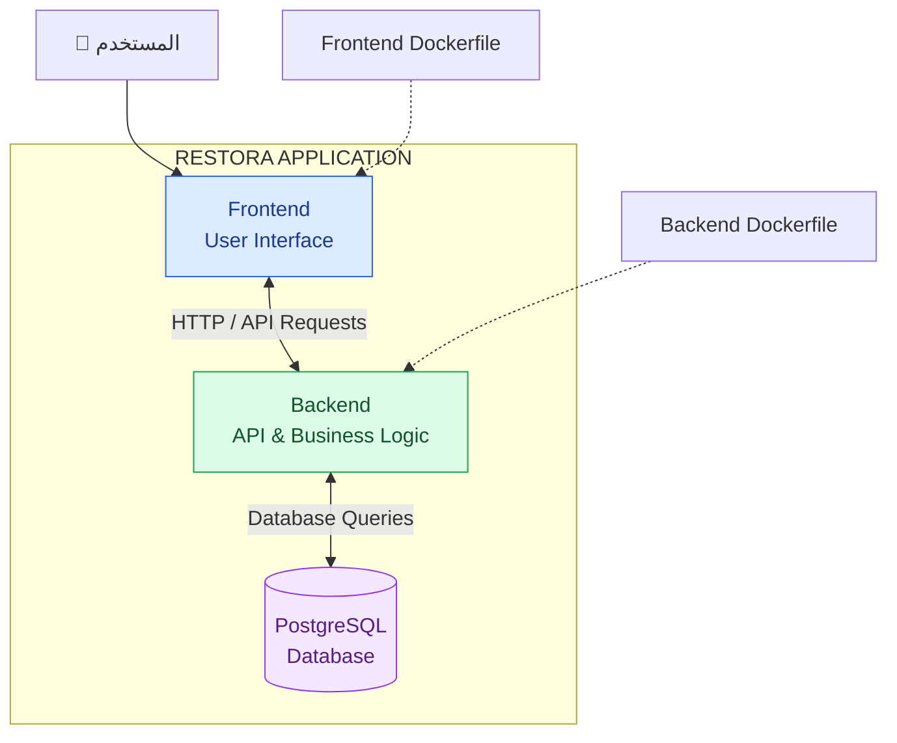
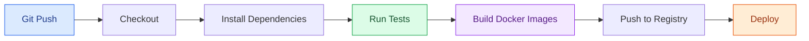

# RESTORA 🍽️

### نظام رقمي لإدارة المطاعم والطلبات

**RESTORA** هو مشروع لتطوير نظام رقمي يساعد المطاعم على إدارة المنيو والمنتجات والطلبات من خلال تطبيق يعتمد على فصل الواجهة الأمامية (Frontend) عن الخدمة الخلفية (Backend)، مع قاعدة بيانات علائقية لتخزين البيانات وإدارة العلاقات بينها.

يتم تطوير المشروع تدريجيًا بدايةً من نسخة أولية بسيطة، مع مراعاة قابلية الصيانة والتوسع وإمكانية إضافة الأتمتة والبنية التحتية المناسبة في الإصدارات القادمة.

---

## 📌 Project Overview

يهدف المشروع إلى بناء أساس تقني منظم لنظام إدارة المطاعم، مع تطبيق مفاهيم Software Engineering وDatabase Design وContainerization بصورة عملية.

### الأهداف الرئيسية

- بناء تطبيق يفصل بين الـ Frontend والـ Backend.
- تصميم قاعدة بيانات منظمة باستخدام PostgreSQL.
- إنشاء Dockerfile مستقل لكل تطبيق.
- تجهيز سكريبت تثبيت وتشغيل تلقائي على Linux.
- توثيق الـ Architecture والـ Database Schema.
- تجهيز المشروع للتوسع وإضافة Authentication وAuthorization.
- التخطيط لإضافة CI/CD وInfrastructure Automation مستقبلًا.

---

## 🏗️ System Architecture

تعتمد المعمارية المبدئية على ثلاثة مكونات رئيسية: Frontend وBackend وDatabase.



### مكونات النظام

| المكون | المسؤولية |
|---|---|
| Frontend | عرض واجهة المستخدم والتعامل مع البيانات وإرسال طلبات الـ API. |
| Backend | تنفيذ الـ Business Logic والتحقق من البيانات ومعالجة الطلبات. |
| PostgreSQL | تخزين البيانات والعلاقات والقيود الخاصة بقاعدة البيانات. |
| Docker | تجهيز بيئة تشغيل مستقلة لكل من الـ Frontend والـ Backend. |
| Installer Script | فحص متطلبات التشغيل على Linux وتجهيز البيئة تدريجيًا. |

> يوضح الرسم المعمارية المنطقية المستهدفة، وليس بالضرورة طريقة الاستضافة الحالية. سيتم توثيق الـ Deployment Architecture بصورة مستقلة عند تحديد بيئة النشر.

---

## 📁 Repository Structure

```text
restora/
│
├── frontend/
│   ├── Dockerfile
│   └── ... Frontend Source Code
│
├── backend/
│   ├── Dockerfile
│   └── ... Backend Source Code
│
├── scripts/
│   └── install.sh
│
├── docs/
│   └── erd/
│       └── restora-initial-erd.png
│
├── .gitignore
└── README.md
```

### تنظيم المشروع

- `frontend/`: يحتوي على كود الواجهة الأمامية وملف Dockerfile الخاص بها.
- `backend/`: يحتوي على كود الـ API والـ Business Logic وملف Dockerfile الخاص به.
- `scripts/`: يحتوي على سكريبتات التثبيت والتشغيل والصيانة.
- `docs/`: يحتوي على التوثيق الفني، مثل رسومات الـ ERD والـ Architecture.
- `README.md`: الملف الرئيسي لشرح المشروع وطريقة تشغيله وخطة تطويره.

سيتم إضافة مجلد مستقل للـ Infrastructure عند بدء تنفيذ ملفات Terraform أو Ansible أو Kubernetes فعليًا، بدلًا من إنشاء مجلد غير مستخدم في المرحلة الحالية.

---

## 🗄️ Database Design

تتمحور قاعدة البيانات المبدئية حول إدارة العملاء والمنتجات والطلبات.

### Initial Entities

| Entity | الوصف |
|---|---|
| `customers` | بيانات العملاء. |
| `products` | بيانات المنتجات وأسعارها الحالية وحالة توفرها. |
| `orders` | بيانات الطلب الرئيسي، مثل العميل والحالة وتاريخ الإنشاء. |
| `order_items` | تفاصيل الأصناف الموجودة داخل كل طلب، بما فيها الكمية والسعر وقت الطلب واسم المنتج وقت البيع. |

### العلاقات الرئيسية

- Customer واحد يمكن أن يكون مرتبطًا بعدة Orders.
- Order واحد يمكن أن يحتوي على عدة Order Items.
- Product واحد يمكن أن يظهر في عدة Order Items.
- يتم تمثيل العلاقة بين Orders وProducts من خلال جدول `order_items`.

### Historical Order Data

يحتفظ `order_items` بنسخة من اسم المنتج وسعر الوحدة وقت إنشاء الطلب، حتى تظل الفاتورة التاريخية صحيحة عند تغيير بيانات المنتج لاحقًا.

كما يجب تجنب حذف سطور الطلبات التاريخية عند حذف منتج. ويمكن استخدام `ON DELETE SET NULL` على مرجع المنتج مع الاحتفاظ بالبيانات التاريخية، أو استخدام Soft Delete للمنتجات وفقًا لسياسة النظام.

### Initial ERD


> هذا رسم مبدئي لوحدة الطلبات، وسيتم تحديثه بالتزامن مع تطور الـ Requirements والـ Database Schema.

---

## 🐳 Docker & Containerization

يستخدم المشروع Docker لتوحيد طريقة بناء وتشغيل مكونات التطبيق.

سيحتوي كل تطبيق على Dockerfile مستقل:

- **Frontend Dockerfile:** لبناء صورة تشغيل الواجهة الأمامية.
- **Backend Dockerfile:** لبناء صورة تشغيل الـ API والـ Business Logic.

### مبادئ التشغيل

- فصل إعدادات التشغيل عن الكود.
- تمرير معلومات الاتصال بقاعدة البيانات من خلال Environment Variables.
- عدم تضمين كلمات المرور أو الأسرار داخل Docker Images أو Git Repository.
- استخدام إعدادات مناسبة لبيئة Production عند تجهيز النسخ النهائية.
- تحديد طريقة تشغيل قاعدة البيانات وفقًا لبيئة الاستضافة.

وجود Dockerfile لا يعني أن عملية النشر الآلي قد تم تنفيذها؛ فهو خطوة أولى لتوحيد بناء التطبيقات وتشغيلها.

---

## ⚙️ Automated Installation on Linux

من المخطط توفير سكريبت باسم `scripts/install.sh` لتسهيل تجهيز بيئة التشغيل على خادم Linux.

### المهام المستهدفة

1. التحقق من وجود Docker على النظام.
2. عرض إصدار Docker ومعلومات المستخدم الحالي.
3. التأكد من أن Docker Daemon يعمل.
4. التحقق من صلاحيات المستخدم الحالي لتنفيذ أوامر Docker.
5. تثبيت Docker عند عدم وجوده، باستخدام الطريقة الرسمية المناسبة لتوزيعة Linux.
6. إعداد الخدمة والصلاحيات المطلوبة بطريقة آمنة.
7. تنزيل المشروع أو جلب آخر نسخة معتمدة منه.
8. بناء Docker Images وتشغيل التطبيق بعد التحقق من الإعدادات اللازمة.

### Security Considerations

يجب ألا يتجاوز السكريبت مراحل التحقق عند وجود أخطاء في الصلاحيات أو تشغيل الخدمة.

كما يجب التعامل بحذر مع مجموعة `docker`؛ لأن العضوية فيها تمنح المستخدم صلاحيات واسعة قد تعادل صلاحيات root.

يجب مراجعة مصادر التنزيل، والتحقق من إعدادات البيئة والأسرار، وتجنب تنفيذ أوامر غير موثوقة بصلاحيات مرتفعة.

> يتم تنفيذ هذه المهام تدريجيًا. أي خطوة لم تُنفّذ فعليًا تظل ضمن خطة التطوير ولا تعتبر وظيفة مكتملة.

---

## 🔐 Authentication & Authorization

من المخطط إضافة نظام للمصادقة وإدارة الصلاحيات في أحد الإصدارات القادمة.

### Authentication

التحقق من هوية المستخدم، وتحديد آلية تسجيل الدخول وإدارة الجلسات أو الرموز وفقًا لمتطلبات النظام.

### Authorization

تحديد العمليات والبيانات التي يمكن لكل مستخدم الوصول إليها.

ومع تطور النظام لدعم تعدد المطاعم والفروع، يجب أن ترتبط الصلاحيات بنطاق المطعم والفرع المناسبين، لمنع الوصول غير المصرح به إلى البيانات.

### Security Requirements

- تخزين كلمات المرور باستخدام خوارزمية مخصصة وآمنة لتجزئتها، وليس كنص صريح.
- حماية الـ API من الوصول غير المصرح به.
- التحقق من صلاحيات المستخدم على الخادم، وليس في الواجهة الأمامية فقط.
- إدارة الأسرار باستخدام Environment Variables أو آلية مخصصة لإدارة الأسرار.
- إضافة اختبارات للصلاحيات وعزل البيانات بين المطاعم عند تنفيذ تعدد المستأجرين.

هذه الخصائص ضمن خطة التطوير المستقبلية، ولا يُفترض أنها متاحة قبل تنفيذها واختبارها.

---

## 🚀 Development Roadmap

يتم تطوير RESTORA على مراحل، بحيث تمثل كل نسخة توسعًا مدروسًا في الوظائف والبنية التقنية.

### Version 1 — Core Application

**الهدف: بناء أساس بسيط وقابل للتشغيل والتطوير.**

النطاق المستهدف:

- تنظيم الـ Frontend والـ Backend في مجلدين مستقلين.
- تطوير الوظائف الأساسية للـ API.
- تصميم وتنفيذ قاعدة البيانات والعلاقات.
- تجهيز Dockerfile مستقل لكل تطبيق.
- توثيق الـ Architecture والـ ERD.
- إنشاء سكريبت أولي لفحص بيئة Linux وتجهيز التشغيل.
- اختبار الوظائف الأساسية والتأكد من صحة البيانات والعلاقات.

يركز الإصدار الأول على صحة التصميم وسهولة التشغيل والصيانة، دون إضافة تعقيدات غير ضرورية.

### Version 2 — Enhanced Restaurant Experience

**الهدف: توسيع قدرات النظام وتحسين تجربة الاستخدام.**

الخصائص المخطط دراستها وتنفيذها:

- إضافة Authentication وAuthorization.
- دعم تعدد فروع المطعم وإدارة بيانات كل فرع.
- إضافة صور للمنتجات داخل المنيو.
- إضافة رابط موقع المطعم على Google Maps لتسهيل الوصول إليه.
- تطوير الـ Database Schema والـ API لدعم الخصائص الجديدة.
- إضافة التحقق من الصلاحيات وعزل بيانات المطاعم والفروع.

سيتم تحديد نطاق الإصدار وفقًا للأولويات ومتطلبات العمل.

### Version 3 — DevOps & Advanced Capabilities

**الهدف: أتمتة دورة تطوير التطبيق وتجهيز بنية تشغيل أكثر قابلية للتوسع.**

الخصائص المخطط دراستها:

- تطبيق CI/CD باستخدام Jenkins أو GitLab CI/CD.
- أتمتة الاختبارات وبناء Docker Images.
- نشر الصور في Container Registry.
- تنفيذ Deployment آلي إلى بيئة مستهدفة.
- إضافة Infrastructure as Code عند الحاجة.
- تطوير آليات Logging وMonitoring وHealth Checks.
- تحسين الأداء والأمان وقابلية التوسع وفقًا لنتائج الاختبارات.

قد يتم تقديم بعض الخصائص في توقيت مختلف إذا تطلبت الأولويات ذلك.

---

## 🔄 Future CI/CD Strategy

لن يتم إدخال CI/CD Pipeline كاملة في المرحلة الأولى؛ سيتم تجهيز المشروع تدريجيًا بحيث يسهل دمجه مع أداة الأتمتة لاحقًا.

سيتم تقييم Jenkins وGitLab CI/CD واختيار الأنسب وفقًا لطريقة استضافة Git Repository وبيئة التشغيل ومتطلبات الفريق.

### Pipeline Workflow — Planned



هذا مخطط للعملية المستهدفة مستقبلًا، وليس وصفًا لـ Pipeline منفذة حاليًا.

---

## 🏗️ Future Infrastructure

سيتم إضافة مجلد `infrastructure/` عندما يبدأ المشروع في إدارة البنية التحتية ككود.

قد يشمل التنظيم المستقبلي:

```text
infrastructure/
├── terraform/
├── ansible/
└── kubernetes/
```

لن يتم اعتماد جميع هذه الأدوات بالضرورة؛ سيتم اختيار الأدوات المناسبة وفقًا لاحتياجات المشروع وبيئة الاستضافة.

الهدف هو إضافة التعقيد عند وجود حاجة فعلية إليه، مع الحفاظ على بساطة الإصدار الأول.

---

## 📋 Current Status

المشروع في مرحلة التطوير الأولي، ويتم بناء مكوناته وتوثيقها تدريجيًا.

تمثل Version 1 الأساس الذي ستُبنى عليه الإصدارات التالية، مع إعطاء الأولوية إلى:

- صحة تصميم قاعدة البيانات.
- فصل المسؤوليات بين المكونات.
- قابلية تشغيل التطبيق وصيانته.
- تجهيز Docker وبيئة Linux.
- وضوح خطة التطوير المستقبلية.

لن يتم اعتبار أي خاصية مكتملة إلا بعد تنفيذها والتحقق من عملها.

---

## 🛠️ Technology Stack

سيتم تثبيت التقنيات النهائية وفقًا للتنفيذ الفعلي لكل مكون.

| المجال | التقنية المستهدفة |
|---|---|
| Frontend | وفقًا لاختيار إطار الواجهة المستخدم |
| Backend | وفقًا لاختيار إطار وخدمة الـ API |
| Database | PostgreSQL |
| Containerization | Docker |
| Operating System | Linux |
| CI/CD | Jenkins أو GitLab CI/CD — مستقبلًا |
| Infrastructure as Code | وفقًا للاحتياجات المستقبلية |

---

## 📖 Documentation

يتم الاحتفاظ بالوثائق الفنية داخل مجلد `docs/`، بما يشمل:

- رسومات الـ ERD.
- توثيق الـ Architecture.
- قرارات التصميم الفني عند الحاجة.
- تحديثات الـ Database Schema مع تطور المشروع.

---

## 🤝 Development Principles

يعتمد تطوير المشروع على المبادئ التالية:

- البدء بالأساسيات قبل إضافة التعقيد.
- توثيق القرارات المهمة.
- فصل المسؤوليات بين المكونات.
- الحفاظ على سلامة البيانات والعلاقات.
- عدم إدخال أدوات أو تقنيات دون حاجة واضحة.
- تطوير النظام على مراحل قابلة للاختبار والصيانة.

---

**RESTORA — Building the foundation first, scaling with purpose.**